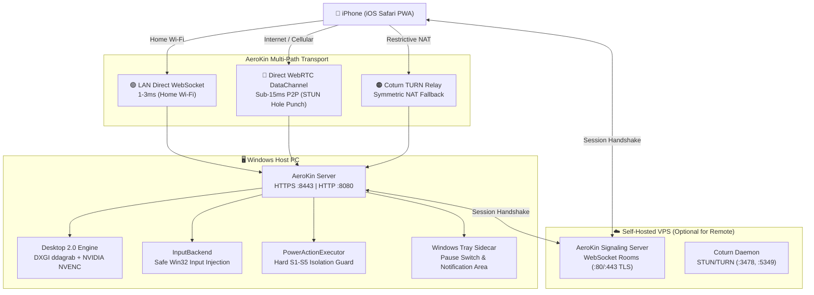

# AEROKIN ⚡

**Sovereign Remote PC Control for iOS & Web**

Control your Windows PC from your iPhone from **anywhere** — whether you are sitting on your couch on your home Wi-Fi or traveling across the world on cellular LTE/5G. AeroKin delivers a responsive, low-latency, Chrome-Remote-Desktop-grade experience using its own self-hosted UI, with **zero third-party dependencies** (no Tailscale, AnyDesk, TeamViewer, or third-party cloud services).

---

## ✦ Highlights

- **Multi-Path Transport**: Automatically selects the fastest available path:
  1. **Direct LAN WebSocket** (1–3 ms round-trip latency on home Wi-Fi).
  2. **Direct P2P WebRTC DataChannel** (sub-15 ms peer-to-peer via STUN hole punching when away from home).
  3. **Self-Hosted Coturn TURN Relay** (automatic fallback for restrictive symmetric NAT).
- **Desktop 2.0 Streaming Engine**:
  - Direct DXGI Desktop Duplication (`ddagrab`) with NVIDIA NVENC hardware acceleration (`h264_nvenc` ultra-low-latency CBR).
  - In-browser hardware decoding via WebCodecs `VideoDecoder` (`avc1.42001f` baseline) with smooth canvas fallback.
  - Sub-35 ms p50 frame delivery latency with >85% bandwidth reduction over MJPEG.
- **Crafted OLED True-Black PWA**:
  - Purpose-built for iOS Safari and iPhone Dynamic Island / notches (`#000000` canvas, `#0A0A0A` surface, `#FF5A1F` kinetic accent).
  - 16px minimum font size to eliminate unwanted iOS Safari auto-zoom.
  - Multi-touch sub-pixel trackpad with configurable sensitivity, haptics, and natural scrolling.
  - Smooth 1x–4x pinch-to-zoom with midpoint delta panning and touch-coordinate inverse projection.
  - Virtual modifier bar (`CTRL`, `ALT`, `SHIFT`, `WIN` sticky latching) and dedicated function keys.
- **AeroKin Drop**: Direct, authenticated file transfer from mobile to PC (up to 50MB) with strict path traversal protection.
- **Multi-PC Switcher**: Pair multiple desktop computers and switch between them in 1-tap with persistent identities.
- **Tray Sidecar & Emergency Pause**: Hardware system tray sidecar and PC dashboard toggle to instantly pause or resume all remote inputs.
- **Hard Safety Architecture**: Mandatory static safety checks (`pnpm run safety:check`) guarding all power and input boundaries. Real shutdown/reboot commands are strictly impossible during tests or CI.

---

## 🏛️ Architecture



> **Video frames never route through the Node signaling server.** All media and input traffic travel directly between the iPhone and the Windows host via encrypted WebRTC DataChannels or encrypted local WebSockets.

---

## 🚀 Quickstart

### 1. Windows Host Setup

#### Prerequisites
- Windows 10/11 (x64)
- Node.js 20+ and `pnpm` (`npm install -g pnpm`)
- Dedicated GPU (NVIDIA RTX/GTX recommended; Intel QuickSync / AMD AMF / software x264 supported)

#### Automated Provisioning & Launch
```powershell
# Clone the repository
git clone https://github.com/AllenJohnn/aerokin.git
cd aerokin

# Install dependencies and build
pnpm install
pnpm run build

# Provision FFmpeg with NVENC hardware acceleration
powershell -ExecutionPolicy Bypass -File scripts/provision-ffmpeg.ps1

# Start AeroKin server (HTTPS :8443, HTTP :8080)
pnpm start
```

Alternatively, double-click `scripts/start-aerokin.bat` to launch the server and the Windows Tray sidecar.

---

### 2. iPhone Mobile Setup

1. **Install Local Root CA (First time only, for zero SSL warnings on LAN)**:
   - Connect your iPhone to the same Wi-Fi network as your PC.
   - Open iPhone Camera and scan the **SSL Certificate Trust Setup** QR code on the PC Dashboard (`http://<PC_IP>:8080`).
   - Tap **Allow** when prompted to download the configuration profile.
   - Open iOS **Settings** &rarr; **Profile Downloaded** &rarr; tap **Install**.
   - Navigate to **Settings** &rarr; **General** &rarr; **About** &rarr; **Certificate Trust Settings** and toggle **Full Trust** for `AEROKIN Root CA`.
2. **Pair Your Phone**:
   - Open Safari and navigate to `https://<PC_IP>:8443/` or scan the pairing QR code from the PC Dashboard.
   - Enter the active 8-digit code and approve the connection on your PC.
3. **Add to Home Screen**:
   - In Safari, tap the **Share** button &rarr; tap **Add to Home Screen**.
   - Launch AeroKin from your Home Screen for an edge-to-edge true-black OLED experience with custom haptics and no browser address bar.

---

### 3. Remote WebRTC Setup (Access from Anywhere)

To control your PC from cellular data or remote networks without third-party services, deploy the lightweight AeroKin signaling service and Coturn daemon to any small VPS (e.g. Hetzner, DigitalOcean, Linode):

1. **Deploy VPS Infrastructure**:
   ```bash
   cd signaling
   # Review deployment documentation
   cat ../docs/DEPLOYMENT.md
   
   # Run automated one-command VPS setup
   bash deploy.sh
   ```
2. **Point Host to Signaling**:
   Set the signaling endpoint on your Windows host:
   ```powershell
   $env:AEROKIN_SIGNALING_URL = "wss://signal.yourdomain.com"
   pnpm start
   ```
3. **Remote Pairing**:
   On the PC Dashboard, toggle to **Remote WebRTC Pairing**. Scan the QR code or tap **Copy Remote Link** (`aerokin://pair?pcId=...&code=...`). Your iPhone will securely pair and automatically maintain WebRTC P2P connectivity whether on LAN or mobile data.

---

## 🔒 Hard Safety & Security Rules

AeroKin is designed with strict security invariants to prevent accidental power operations or malicious takeovers:

| Invariant | Description |
|-----------|-------------|
| **S1: Power Isolation** | Real power operations (Windows shutdown, restart, sleep, and session lock) are strictly isolated to `PowerActionExecutor.ts`. The rest of the codebase is statically scanned and verified via `pnpm run safety:check`. |
| **S2: Test & CI Throw Guard** | Under `VITEST`, `NODE_ENV=test`, or CI, constructing the real power executor or real input backend throws immediately. Tests only interact with `RecordingPowerActionExecutor` and `RecordingInputBackend`. |
| **S3: Explicit Opt-In** | The host PC will only execute real power operations if `process.env.AEROKIN_ALLOW_POWER_ACTIONS === '1'` is explicitly set by the operator. |
| **S4: Input Pause Switch** | Operators can instantly drop all remote touch, mouse, and keyboard events using the Windows System Tray sidecar or PC Dashboard toggle. |
| **S5: Loopback-Only Management** | Administrative and diagnostic endpoints (`/api/dashboard/*`) require loopback origin (`127.0.0.1` / `::1`) and return `403 Forbidden` for external LAN requests. |
| **S6: Rate Limiting & Lockout** | Failed pairing attempts trigger exponential lockouts and global code invalidation after 5 incorrect entries. |

---

## 📊 Desktop 2.0 Streaming Benchmarks

Synthetic benchmark results on an NVIDIA GeForce RTX 4060 Laptop GPU:

| Preset | Resolution | Codec | Encoder | FPS | p50 Latency | p95 Latency | Avg Frame | Bitrate | FFmpeg CPU |
|--------|------------|-------|---------|-----|-------------|-------------|-----------|---------|------------|
| **High** | 1920x1080 | H.264 | `h264_nvenc` | 28.4 | 31 ms | 35 ms | 14.3 KB | 3.16 Mbps | 0.4% |
| **Balanced** | 1440x810 | H.264 | `h264_nvenc` | 29.3 | 31 ms | 46 ms | 8.2 KB | 1.87 Mbps | 1.2% |
| **Legacy** | 1440x810 | MJPEG | Software | 35.0 | 31 ms | 47 ms | 48.9 KB | 13.35 Mbps | 2.6% |

> H.264 hardware encoding achieves an **>85% reduction in network bandwidth** compared to MJPEG while maintaining sub-35 ms frame delivery.

---

## 🧪 Verification & Testing

AeroKin features a comprehensive test suite across client, server, and signaling components:

```bash
# Mandatory pre-commit static safety check
pnpm run safety:check

# Run PWA client tests (84 tests)
pnpm --filter aerokin-pwa test

# Run signaling server tests (10 tests)
pnpm --filter aerokin-signaling test

# Run server unit & integration tests (240 tests)
pnpm --filter aerokin-server test

# Run desktop streaming synthetic benchmark
pnpm --filter aerokin-server run bench:desktop -- --synthetic
```

---

## 📂 Project Structure

```text
aerokin/
├── pwa/                 # iOS & Mobile Safari PWA client (React 18 + Vite + Tailwind)
│   ├── src/components/  # OLED trackpad, desktop viewer, multi-PC switcher, dashboard
│   ├── src/transport/   # WebRTC RtcTransport, ConnectionManager, FrameSink
│   └── src/hooks/       # useAerokinSocket, useDesktopStream, useGestures
├── server/              # Windows Node.js host server
│   ├── src/desktop/     # DXGI capture, NVENC pipeline, StreamService
│   ├── src/actions/     # PowerActionExecutor (S1 isolation), QuickActionService
│   ├── src/input/       # InputBackend (safe mouse/keyboard injection)
│   ├── src/transport/   # SignalingClient, DataChannel chunking & reassembly
│   └── scripts/         # Tray sidecar (PowerShell), benchmarking tools
├── signaling/           # Self-hosted WebRTC signaling service & Coturn IaC
│   ├── src/             # SignalingServer (WebSocket rooms), turn.ts (HMAC-SHA1)
│   ├── docker-compose.yml # Container orchestration (Signaling + Coturn + Caddy)
│   └── deploy.sh        # One-command Ubuntu VPS deployment script
├── packages/
│   └── design-system/   # Shared OLED true-black design tokens and UI components
├── scripts/             # Safety guards, FFmpeg provisioning, 1-click Windows launcher
└── docs/                # Architecture, deployment guide, progress checklist
```

---

## 📄 License

MIT © Allen John
