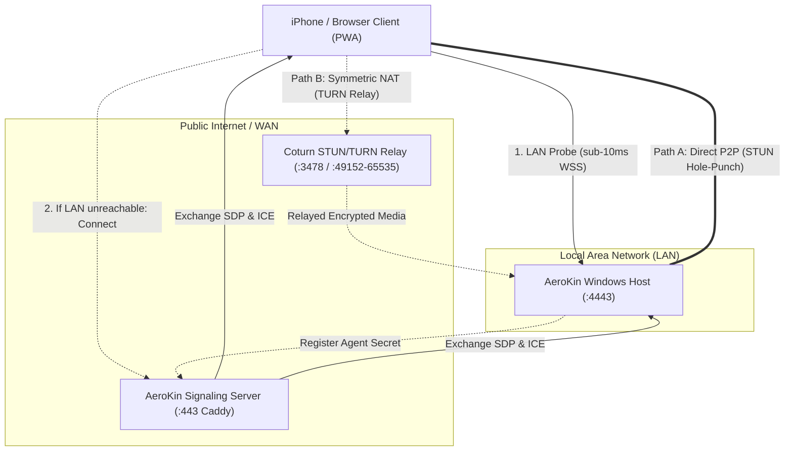
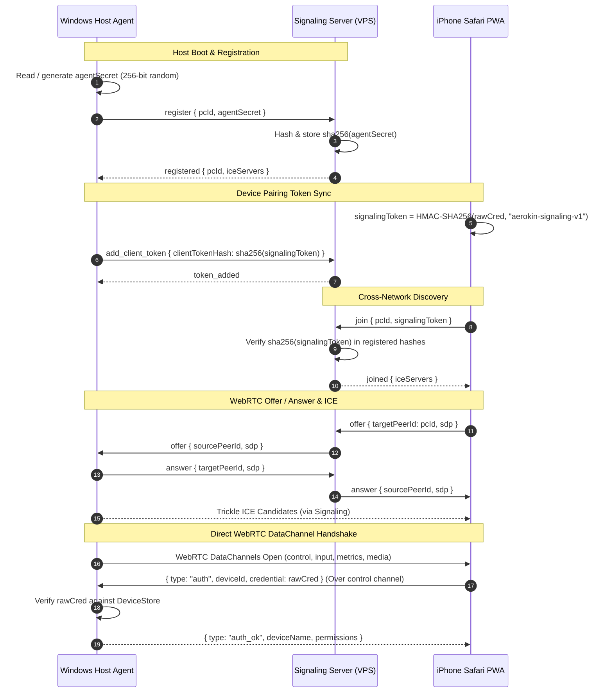
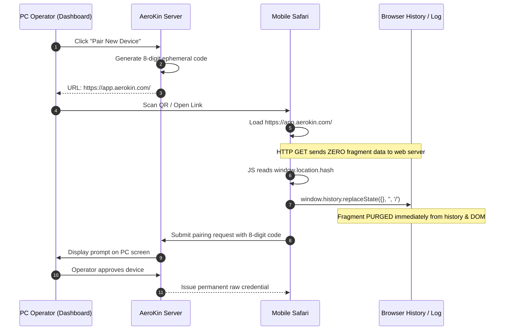
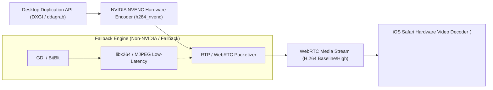

# AeroKin System Architecture & Transport Topology

AeroKin is a zero-third-party remote desktop and control platform providing seamless, low-latency control of a Windows PC from an iPhone or browser client. It maintains a dual-path architecture: ultra-low latency direct LAN mode when on the same network, and encrypted WebRTC (P2P STUN or Coturn TURN relay) when operating across cellular and WAN networks.

---

## 1. Multi-Path Transport Hierarchy

AeroKin prioritizes connections strictly by latency and overhead. LAN WebSocket is preferred whenever available; otherwise, WebRTC negotiates the most direct possible route.

### Transport Path Resolution

1. **Path 1: LAN Direct (WebSocket over TLS)**
   - Target: `wss://<pc-lan-ip>:4443`
   - Latency: < 5–10ms
   - Encryption: TLS 1.3 with pinned local CA certificate
   - Used when iPhone and PC share the same Wi-Fi subnet.
2. **Path 2: WebRTC Direct P2P (STUN Hole-Punching)**
   - Target: Direct UDP peer connection via STUN `srflx` candidates
   - Latency: 20–50ms
   - Encryption: DTLS-SRTP for media, DTLS DataChannels for control/input
   - Used when traversing standard NATs and cellular networks without symmetric port randomization.
3. **Path 3: WebRTC Coturn Relay (TURN)**
   - Target: Relayed via self-hosted Coturn daemon
   - Latency: 40–80ms
   - Encryption: End-to-end DTLS (Coturn forwards raw encrypted UDP packets; cannot inspect payload)
   - Used when both ends are behind restrictive enterprise or carrier-grade NATs.

---

## 2. Signaling Protocol & In-Band Authentication Sequence

AeroKin completely separates signaling presence from host authentication. The public signaling server *never* learns device credentials.

---

## 3. Remote URL Fragment Pairing Flow

To prevent accidental disclosure of 8-digit pairing codes in web server access logs, AeroKin uses client-side URL fragments (`#`) rather than query parameters (`?`).

---

## 4. Windows Desktop Video Capture Pipeline

AeroKin captures the Windows desktop with hardware acceleration, minimizing CPU usage and battery drain.

### Video Performance Targets
- **Resolution**: Native 1080p (1920x1080) or custom viewport scale.
- **Framerate**: 60 FPS (with automatic 30 FPS throttling on mobile battery saver).
- **Latency**: 30–65ms glass-to-glass latency over local Wi-Fi, < 100ms over cellular.
- **Codec Negotiation**: H.264 profile-level-id `42e01f` (constrained baseline) for universal iOS Safari hardware decoding.
